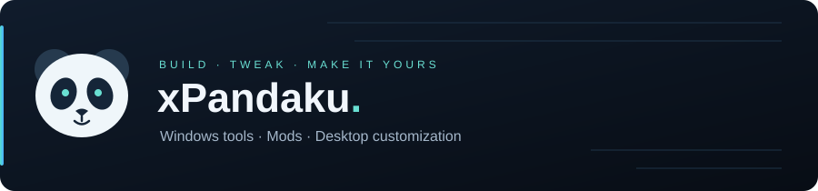

# Hey, I'm xPandaku 🐼

  

  
  
  

### 💫 About me

- 🖥️ I build Windows desktop tools, live wallpaper HUDs, and customization projects.
- 🛠️ I make game mods and plugins that simplify everyday tasks.
- 🐼 Currently working on:
  - [HUD Live OLED](https://github.com/xBandaku/HUD-Live-OLED) — Windows wallpaper HUD for system telemetry, audio visualization, and per-monitor OLED care.
  - [HideOwnStreamPreview](https://github.com/xBandaku/HideOwnStreamPreview) — Equicord plugin that hides your own floating stream preview.
- 💬 Have a bug report or an idea? Open an issue in the relevant project.

<h2>📘 Featured projects</h2>

  
  

  
  

<a href="https://github.com/xBandaku/HUD-Live-OLED/releases/latest">Download HUD Live OLED</a> · <a href="https://github.com/xBandaku/HUD-Live-OLED#release-packages">Build and release instructions</a> · <a href="https://github.com/xBandaku/HideOwnStreamPreview#installation">Install HideOwnStreamPreview</a>

Public, non-fork repositories are listed automatically, newest first.

<!-- featured:start -->
- [xBandaku/HUD-Live-OLED](https://github.com/xBandaku/HUD-Live-OLED) — Windows live wallpaper HUD with system telemetry, audio visualization, themes, named profiles, and per-monitor OLED care.
- [xBandaku/HideOwnStreamPreview](https://github.com/xBandaku/HideOwnStreamPreview) — Equicord userplugin that hides your own floating screen-share preview without stopping your broadcast.
- [xBandaku/GLSS](https://github.com/xBandaku/GLSS) — GLSS - Girl Life School Skip: a mod for Girl Life \(ECV, 18+\) that automates or skips the in-game school and university routines
- [xBandaku/GLQS](https://github.com/xBandaku/GLQS) — Quick-setup cheat mod for Girl Life ECV. One in-game menu for clothing, stats, money, relationships, jobs, presets and more.
<!-- featured:end -->

[Browse all my repositories →](https://github.com/xBandaku?tab=repositories)

<h2>📕 Projects I've contributed to</h2>

  
  
  

Repositories with your merged public pull requests are listed automatically.

<!-- contributed:start -->
- [Deadlineem/Extras\_Addon](https://github.com/Deadlineem/Extras_Addon) — [Merged PR: Update Extras-Addon.lua](https://github.com/Deadlineem/Extras_Addon/pull/91)
- [kuska1/Material-Theme](https://github.com/kuska1/Material-Theme) — [Merged PR: fix: restore Store search, home card, calendar and Discovery Queue styling](https://github.com/kuska1/Material-Theme/pull/69)
- [xBandaku/Material-Theme](https://github.com/xBandaku/Material-Theme) — [Merged PR: CI: run the existing tests on pull requests](https://github.com/xBandaku/Material-Theme/pull/1)
- [xBandaku/TwitchAdSolutions](https://github.com/xBandaku/TwitchAdSolutions) — [Merged PR: Add a live background-tab harness \(npm run live:background\)](https://github.com/xBandaku/TwitchAdSolutions/pull/78)
- [Zenix-Al/f95-zone-highlighter](https://github.com/Zenix-Al/f95-zone-highlighter) — [Merged PR: Remember dismissed notices, show library site blocks, harden test runner, upgrade happy-dom](https://github.com/Zenix-Al/f95-zone-highlighter/pull/83)
<!-- contributed:end -->

### 💻 Tech stack

<!-- languages:start -->

<!-- languages:end -->

<h2>📊 Stats and contributions</h2>

### 🐍 Contributions

<picture>
  <source media="(prefers-color-scheme: dark)" srcset="assets/github-snake-dark.svg" />
  <source media="(prefers-color-scheme: light)" srcset="assets/github-snake.svg" />
  
</picture>

<h2>⚡ Recent GitHub activity</h2>

### 🌱 My latest projects

<!-- projects:start -->
- [xBandaku/HUD-Live-OLED](https://github.com/xBandaku/HUD-Live-OLED) — Windows live wallpaper HUD with system telemetry, audio visualization, themes, named profiles, and per-monitor OLED care.
- [xBandaku/HideOwnStreamPreview](https://github.com/xBandaku/HideOwnStreamPreview) — Equicord userplugin that hides your own floating screen-share preview without stopping your broadcast.
- [xBandaku/GLSS](https://github.com/xBandaku/GLSS) — GLSS - Girl Life School Skip: a mod for Girl Life \(ECV, 18+\) that automates or skips the in-game school and university routines
- [xBandaku/GLQS](https://github.com/xBandaku/GLQS) — Quick-setup cheat mod for Girl Life ECV. One in-game menu for clothing, stats, money, relationships, jobs, presets and more.
<!-- projects:end -->

### 🔨 My recent Pull Requests

<!-- prs:start -->
- [fix\(vaft\): port hidden tab handling fixes from xBandaku/TwitchAdSolutions](https://github.com/Helli24/TwitchAdSolutions/pull/35) on [Helli24/TwitchAdSolutions](https://github.com/Helli24/TwitchAdSolutions)
- [Add a live background-tab harness \(npm run live:background\)](https://github.com/xBandaku/TwitchAdSolutions/pull/78) on [xBandaku/TwitchAdSolutions](https://github.com/xBandaku/TwitchAdSolutions)
- [Skip the vaft post-break wedge check on hidden pages \(vaft 68.5.49\)](https://github.com/xBandaku/TwitchAdSolutions/pull/77) on [xBandaku/TwitchAdSolutions](https://github.com/xBandaku/TwitchAdSolutions)
- [Defer vaft player reloads while the page is hidden \(\#74, vaft 68.5.48\)](https://github.com/xBandaku/TwitchAdSolutions/pull/76) on [xBandaku/TwitchAdSolutions](https://github.com/xBandaku/TwitchAdSolutions)
- [Keep background playback alive across vaft reloads \(\#74\)](https://github.com/xBandaku/TwitchAdSolutions/pull/75) on [xBandaku/TwitchAdSolutions](https://github.com/xBandaku/TwitchAdSolutions)
<!-- prs:end -->

### ⭐ Recent Stars

<!-- stars:start -->
- [brave/brave-browser](https://github.com/brave/brave-browser) — Brave browser for Android, iOS, Linux, macOS, Windows.
- [brave/brave-core](https://github.com/brave/brave-core) — Core engine for the Brave browser for mobile and desktop. For issues https://github.com/brave/brave-browser/issues
- [fxceless/victory-fork](https://github.com/fxceless/victory-fork) — Work-in-progress fork of VIctory: getting an Xbox Series title to render and run on a Windows PC. No game files.
- [Marvisak/VIctory](https://github.com/Marvisak/VIctory) — An attempt at running GTA VI on PC
- [madmaxgrey/AchievementManager](https://github.com/madmaxgrey/AchievementManager) — Achievement Manager for Steam 
<!-- stars:end -->

### 📫 Find me

- Twitch: [xkangoku](https://www.twitch.tv/xkangoku)
- YouTube: [@iPandaku](https://www.youtube.com/@iPandaku)
- Bugs and ideas: open an issue in the relevant project.

---

Stats and activity refresh daily from public GitHub data.

Profile section inspiration: [Z3phyr1s](https://github.com/Z3phyr1s/Z3phyr1s) and [DenverCoder1](https://github.com/DenverCoder1/DenverCoder1). Contribution animation powered by [Platane/snk](https://github.com/Platane/snk).
