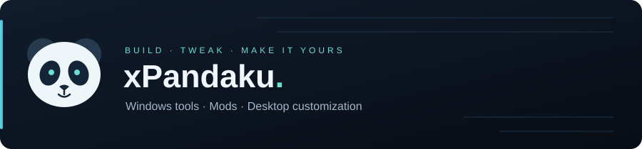

# Hey, I'm xPandaku 🐼

Windows desktop tools, game mods, and small fixes for everyday annoyances.

### 💫 About me

- 🖥️ I build Windows desktop tools, live wallpaper HUDs, and customization projects.
- 🛠️ I make game mods and plugins that simplify everyday tasks.
- 🐼 Currently working on **HUD Live OLED** and **HideOwnStreamPreview**.
- 💬 Have a bug report or an idea? Open an issue in the relevant project.

### 💻 Tech stack

### Socials

### GitHub Stats

### 🐍 Contributions

<picture>
  <source media="(prefers-color-scheme: dark)" srcset="assets/github-snake-dark.svg" />
  <source media="(prefers-color-scheme: light)" srcset="assets/github-snake.svg" />
  
</picture>

### 👷 What I'm currently working on

- **[HUD Live OLED](https://github.com/xBandaku/HUD-Live-OLED)** — A Windows wallpaper HUD with live system stats, audio visualization, themes, and per-monitor OLED care. Includes the JARVIS / SHIELD edition.
- **[HideOwnStreamPreview](https://github.com/xBandaku/HideOwnStreamPreview)** — An Equicord plugin that hides your own floating screen-share preview while keeping your stream running.

### 🌱 My latest projects

<!-- projects:start -->
- [xBandaku/HUD-Live-OLED](https://github.com/xBandaku/HUD-Live-OLED) — Windows live wallpaper HUD with system telemetry, audio visualization, themes, named profiles, and per-monitor OLED care.
- [xBandaku/HideOwnStreamPreview](https://github.com/xBandaku/HideOwnStreamPreview) — Equicord userplugin that hides your own floating screen-share preview without stopping your broadcast.
- [xBandaku/GLSS](https://github.com/xBandaku/GLSS) — GLSS - Girl Life School Skip: a mod for Girl Life \(ECV, 18+\) that automates or skips the in-game school routine
- [xBandaku/GLQS](https://github.com/xBandaku/GLQS) — Girl Life Quick Start
<!-- projects:end -->

### 🔨 My recent Pull Requests

<!-- prs:start -->
- [Fix JARVIS audio switching, startup attachment recovery, and feed cleanup](https://github.com/xBandaku/HUD-Live-OLED/pull/13) on [xBandaku/HUD-Live-OLED](https://github.com/xBandaku/HUD-Live-OLED)
- [Fix audio output switching, desktop attachment retries, and feed cleanup](https://github.com/xBandaku/HUD-Live-OLED/pull/10) on [xBandaku/HUD-Live-OLED](https://github.com/xBandaku/HUD-Live-OLED)
- [Set up GitHub security workflows, code reviews, sponsorship, and community templates](https://github.com/xBandaku/HUD-Live-OLED/pull/2) on [xBandaku/HUD-Live-OLED](https://github.com/xBandaku/HUD-Live-OLED)
- [Require pull requests and detailed review notes for project changes](https://github.com/xBandaku/HUD-Live-OLED/pull/1) on [xBandaku/HUD-Live-OLED](https://github.com/xBandaku/HUD-Live-OLED)
- [Consolidate CI and fix automated release notifications](https://github.com/xBandaku/TwitchAdSolutions/pull/30) on [xBandaku/TwitchAdSolutions](https://github.com/xBandaku/TwitchAdSolutions)
<!-- prs:end -->

### ⭐ Recent Stars

<!-- stars:start -->
- [xBandaku/HideOwnStreamPreview](https://github.com/xBandaku/HideOwnStreamPreview) — Equicord userplugin that hides your own floating screen-share preview without stopping your broadcast.
- [xBandaku/xBandaku](https://github.com/xBandaku/xBandaku) — My projects, recent activity, and links.
- [Equicord/Equicord](https://github.com/Equicord/Equicord) — The other cutest Discord client mod
- [xBandaku/HUD-Live-OLED](https://github.com/xBandaku/HUD-Live-OLED) — Windows live wallpaper HUD with system telemetry, audio visualization, themes, named profiles, and per-monitor OLED care.
- [xBandaku/TwitchAdSolutions](https://github.com/xBandaku/TwitchAdSolutions) — If you have issues please file them, and I’ll do my best to fix them
<!-- stars:end -->

### 📫 Find me

- Twitch: [xkangoku](https://www.twitch.tv/xkangoku)
- YouTube: [@iPandaku](https://www.youtube.com/@iPandaku)
- Bugs and ideas: open an issue in the relevant project.

---

Stats and activity refresh daily from public GitHub data.

Profile section inspiration: [Z3phyr1s](https://github.com/Z3phyr1s/Z3phyr1s). Contribution animation powered by [Platane/snk](https://github.com/Platane/snk).
