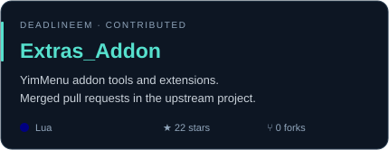
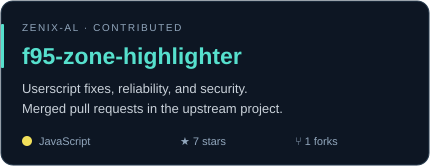

# Hey, I'm xPandaku 🐼

  

  
  
  

### 💫 About me

- 🖥️ I build Windows desktop tools, live wallpaper HUDs, and customization projects.
- 🛠️ I make game mods and plugins that simplify everyday tasks.
- 🐼 Currently working on **HUD Live OLED** and **HideOwnStreamPreview**.
- 💬 Have a bug report or an idea? Open an issue in the relevant project.

<h2>📘 Featured projects</h2>

  
  

  
  

- **[HUD Live OLED](https://github.com/xBandaku/HUD-Live-OLED)** — Includes the JARVIS / SHIELD edition, live system stats, audio visualization, themes, and per-monitor OLED care.
- **[HideOwnStreamPreview](https://github.com/xBandaku/HideOwnStreamPreview)** — Hides your own floating screen-share preview while keeping your stream running.

- **[GLSS](https://github.com/xBandaku/GLSS)** — Automates school and university routines in Girl Life (18+), with one-click days and optional ghost attendance.
- **[GLQS](https://github.com/xBandaku/GLQS)** — In-game quick setup, cheats, resource controls, and character presets for Girl Life (18+).

[Browse all my repositories →](https://github.com/xBandaku?tab=repositories)

<h2>📕 Projects I've contributed to</h2>

  
  

- **[Extras_Addon](https://github.com/Deadlineem/Extras_Addon)** — [Merged contribution](https://github.com/Deadlineem/Extras_Addon/pull/91) to the YimMenu addon.
- **[f95-zone-highlighter](https://github.com/Zenix-Al/f95-zone-highlighter)** — [Merged pull requests](https://github.com/Zenix-Al/f95-zone-highlighter/pulls?q=is%3Apr+is%3Amerged+author%3AxBandaku) covering security fixes, library updates, configuration recovery, and UI reliability.

### 💻 Tech stack

<h2>📊 Stats and contributions</h2>

### 🐍 Contributions

<picture>
  <source media="(prefers-color-scheme: dark)" srcset="assets/github-snake-dark.svg" />
  <source media="(prefers-color-scheme: light)" srcset="assets/github-snake.svg" />
  
</picture>

<h2>⚡ Recent GitHub activity</h2>

### 🌱 My latest projects

<!-- projects:start -->
- [xBandaku/HUD-Live-OLED](https://github.com/xBandaku/HUD-Live-OLED) — Windows live wallpaper HUD with system telemetry, audio visualization, themes, named profiles, and per-monitor OLED care.
- [xBandaku/HideOwnStreamPreview](https://github.com/xBandaku/HideOwnStreamPreview) — Equicord userplugin that hides your own floating screen-share preview without stopping your broadcast.
- [xBandaku/GLSS](https://github.com/xBandaku/GLSS) — GLSS - Girl Life School Skip: a mod for Girl Life \(ECV, 18+\) that automates or skips the in-game school routine
- [xBandaku/GLQS](https://github.com/xBandaku/GLQS) — Girl Life Quick Start
<!-- projects:end -->

### 🔨 My recent Pull Requests

<!-- prs:start -->
- [Release JARVIS 41.0.2 with persistent bottom-aligned taskbars and settings fixes](https://github.com/xBandaku/HUD-Live-OLED/pull/14) on [xBandaku/HUD-Live-OLED](https://github.com/xBandaku/HUD-Live-OLED)
- [Release JARVIS 41.0.1 with audio, startup, and feed recovery fixes](https://github.com/xBandaku/HUD-Live-OLED/pull/13) on [xBandaku/HUD-Live-OLED](https://github.com/xBandaku/HUD-Live-OLED)
- [Fix audio output switching, desktop attachment retries, and feed cleanup](https://github.com/xBandaku/HUD-Live-OLED/pull/10) on [xBandaku/HUD-Live-OLED](https://github.com/xBandaku/HUD-Live-OLED)
- [Set up GitHub security workflows, code reviews, sponsorship, and community templates](https://github.com/xBandaku/HUD-Live-OLED/pull/2) on [xBandaku/HUD-Live-OLED](https://github.com/xBandaku/HUD-Live-OLED)
- [Require pull requests and detailed review notes for project changes](https://github.com/xBandaku/HUD-Live-OLED/pull/1) on [xBandaku/HUD-Live-OLED](https://github.com/xBandaku/HUD-Live-OLED)
<!-- prs:end -->

### ⭐ Recent Stars

<!-- stars:start -->
- [FractalEngineer/RLS-Vehicle-Theft-Chop-Shop-Mod](https://github.com/FractalEngineer/RLS-Vehicle-Theft-Chop-Shop-Mod) — Nice car\! Give me it.
- [Veydr/Veydr](https://github.com/Veydr/Veydr) — Veydr \| Windows tools, cinematic desktops, browser integrations and local AI.
- [xBandaku/HideOwnStreamPreview](https://github.com/xBandaku/HideOwnStreamPreview) — Equicord userplugin that hides your own floating screen-share preview without stopping your broadcast.
- [xBandaku/xBandaku](https://github.com/xBandaku/xBandaku) — My projects, recent activity, and links.
- [Equicord/Equicord](https://github.com/Equicord/Equicord) — The other cutest Discord client mod
<!-- stars:end -->

### 📫 Find me

- Twitch: [xkangoku](https://www.twitch.tv/xkangoku)
- YouTube: [@iPandaku](https://www.youtube.com/@iPandaku)
- Bugs and ideas: open an issue in the relevant project.

---

Stats and activity refresh daily from public GitHub data.

Profile section inspiration: [Z3phyr1s](https://github.com/Z3phyr1s/Z3phyr1s) and [DenverCoder1](https://github.com/DenverCoder1/DenverCoder1). Contribution animation powered by [Platane/snk](https://github.com/Platane/snk).
