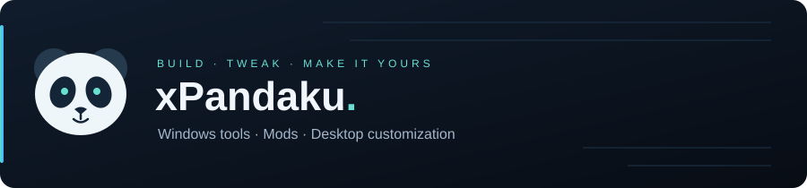

# Hey, I'm xPandaku 🐼

  

  
  
  

### 💫 About me

- 🖥️ I build Windows desktop tools, live wallpaper HUDs, and customization projects.
- 🛠️ I make game mods and plugins that simplify everyday tasks.
- 🐼 Currently working on **HUD Live OLED** and **HideOwnStreamPreview**.
- 💬 Have a bug report or an idea? Open an issue in the relevant project.

<h2>📘 Featured projects</h2>

  
  

  
  

Public, non-fork repositories are listed automatically, newest first.

<!-- featured:start -->
- [xBandaku/HUD-Live-OLED](https://github.com/xBandaku/HUD-Live-OLED) — Windows live wallpaper HUD with system telemetry, audio visualization, themes, named profiles, and per-monitor OLED care.
- [xBandaku/HideOwnStreamPreview](https://github.com/xBandaku/HideOwnStreamPreview) — Equicord userplugin that hides your own floating screen-share preview without stopping your broadcast.
- [xBandaku/GLSS](https://github.com/xBandaku/GLSS) — GLSS - Girl Life School Skip: a mod for Girl Life \(ECV, 18+\) that automates or skips the in-game school routine
- [xBandaku/GLQS](https://github.com/xBandaku/GLQS) — Girl Life Quick Start
<!-- featured:end -->

[Browse all my repositories →](https://github.com/xBandaku?tab=repositories)

<h2>📕 Projects I've contributed to</h2>

  
  

Repositories with your merged public pull requests are listed automatically.

<!-- contributed:start -->
- [Deadlineem/Extras\_Addon](https://github.com/Deadlineem/Extras_Addon) — [Merged PR: Update Extras-Addon.lua](https://github.com/Deadlineem/Extras_Addon/pull/91)
- [xBandaku/TwitchAdSolutions](https://github.com/xBandaku/TwitchAdSolutions) — [Merged PR: Polish README layout and add project badges](https://github.com/xBandaku/TwitchAdSolutions/pull/49)
- [Zenix-Al/f95-zone-highlighter](https://github.com/Zenix-Al/f95-zone-highlighter) — [Merged PR: Remember dismissed notices, show library site blocks, harden test runner, upgrade happy-dom](https://github.com/Zenix-Al/f95-zone-highlighter/pull/83)
<!-- contributed:end -->

### 💻 Tech stack

<!-- languages:start -->

<!-- languages:end -->

<h2>📊 Stats and contributions</h2>

### 🐍 Contributions

<picture>
  <source media="(prefers-color-scheme: dark)" srcset="assets/github-snake-dark.svg" />
  <source media="(prefers-color-scheme: light)" srcset="assets/github-snake.svg" />
  
</picture>

<h2>⚡ Recent GitHub activity</h2>

### 🌱 My latest projects

<!-- projects:start -->
- [xBandaku/HUD-Live-OLED](https://github.com/xBandaku/HUD-Live-OLED) — Windows live wallpaper HUD with system telemetry, audio visualization, themes, named profiles, and per-monitor OLED care.
- [xBandaku/HideOwnStreamPreview](https://github.com/xBandaku/HideOwnStreamPreview) — Equicord userplugin that hides your own floating screen-share preview without stopping your broadcast.
- [xBandaku/GLSS](https://github.com/xBandaku/GLSS) — GLSS - Girl Life School Skip: a mod for Girl Life \(ECV, 18+\) that automates or skips the in-game school routine
- [xBandaku/GLQS](https://github.com/xBandaku/GLQS) — Girl Life Quick Start
<!-- projects:end -->

### 🔨 My recent Pull Requests

<!-- prs:start -->
- [Include fork contributions in profile](https://github.com/xBandaku/xBandaku/pull/5) on [xBandaku/xBandaku](https://github.com/xBandaku/xBandaku)
- [Add badges and refine project cards](https://github.com/xBandaku/xBandaku/pull/4) on [xBandaku/xBandaku](https://github.com/xBandaku/xBandaku)
- [Automatically categorize profile projects](https://github.com/xBandaku/xBandaku/pull/3) on [xBandaku/xBandaku](https://github.com/xBandaku/xBandaku)
- [Add TwitchAdSolutions to contributed projects](https://github.com/xBandaku/xBandaku/pull/2) on [xBandaku/xBandaku](https://github.com/xBandaku/xBandaku)
- [Run profile API requests concurrently](https://github.com/xBandaku/xBandaku/pull/1) on [xBandaku/xBandaku](https://github.com/xBandaku/xBandaku)
<!-- prs:end -->

### ⭐ Recent Stars

<!-- stars:start -->
- [FractalEngineer/RLS-Vehicle-Theft-Chop-Shop-Mod Veydr/Veydr xBandaku/HideOwnStreamPreview xBandaku/xBandaku Equicord/Equicord](https://github.com/FractalEngineer/RLS-Vehicle-Theft-Chop-Shop-Mod https://github.com/Veydr/Veydr https://github.com/xBandaku/HideOwnStreamPreview https://github.com/xBandaku/xBandaku https://github.com/Equicord/Equicord) — Nice car\! Give me it. Veydr \| Windows tools, cinematic desktops, browser integrations and local AI. Equicord userplugin that hides your own floating screen-share preview without stopping your broadcast. My projects, recent activity, and links. The other cutest Discord client mod
<!-- stars:end -->

### 📫 Find me

- Twitch: [xkangoku](https://www.twitch.tv/xkangoku)
- YouTube: [@iPandaku](https://www.youtube.com/@iPandaku)
- Bugs and ideas: open an issue in the relevant project.

---

Stats and activity refresh daily from public GitHub data.

Profile section inspiration: [Z3phyr1s](https://github.com/Z3phyr1s/Z3phyr1s) and [DenverCoder1](https://github.com/DenverCoder1/DenverCoder1). Contribution animation powered by [Platane/snk](https://github.com/Platane/snk).
